<p align="center">
  <picture>
    <source media="(prefers-color-scheme: dark)" srcset="images/tmnas-logo-white.png">
    
  </picture>
</p>

<h1 align="center">TMNAS &times; Harness DevSecOps Workshop</h1>

<p align="center">
  Continuous Integration &bull; DevSecOps &bull; Continuous Delivery &bull; Continuous Verification &bull; Governance &bull; <b>ServiceNow Change Management</b> &bull; Chaos Engineering
</p>

---

Welcome to the hands-on workshop prepared for **Tokio Marine North America Services (TMNAS)**. Over the following labs you will build an end-to-end delivery pipeline for a sample application, harden it with security scanning, derisk releases with canary deployments and continuous verification, put it under change control with **policy as code** and **ServiceNow change requests**, and prove it rolls back on its own when chaos strikes - exactly the guardrails a regulated insurance business needs, without slowing delivery down.

# Table of Contents

- [Lab Pre-read](#lab-pre-read)
- [Lab 1: Build](#lab-1-build)
- [Lab 2: DevSecOps](#lab-2-devsecops)
- [Lab 3: Continuous Deploy - Frontend](#lab-3-continuous-deploy---frontend)
- [Lab 4: Continuous Deploy - Backend](#lab-4-continuous-deploy---backend)
- [Lab 5: Validate Release](#lab-5-validate-release)
- [Lab 6: Governance / Policy as Code](#lab-6-governance--policy-as-code)
- [Lab 7: Governance & Change Management with ServiceNow](#lab-7-governance--change-management-with-servicenow)
- [Lab 8: Production Guardrails](#lab-8-production-guardrails)
- [Lab 9: Resilience Testing & Automated Rollback](#lab-9-resilience-testing--automated-rollback)
- [Lab 10: Governance / Policy as Code (Advanced)](#lab-10-governance--policy-as-code-advanced)

> [!NOTE]
> **Pre-provisioned for you:** your project already contains a **SNOW Approval** stage template, **ServiceNow Close Ticket**, **ServiceNow Close Failed** and **Change Verified** step templates, and the **Approval Required**, **Production Guardrail** and **Change Verified** policies. They all use the shared `workshop-snow` ServiceNow connector.

---

## Lab pre-read

### Changing project
1. From the left-hand side menu, click on **Account**
2. From the top navigation bar, select **Projects**
3. Click the desired project; everything will be scoped to that project


### Changing harness modules
- As part of this lab, we will switch between modules several times

In order to switch modules:
1. Click on the **nine dot** menu icon
2. Select the module relevant to the step
3. The lab begins in the CI/CD module


## Lab 1: Build

## Key Outcomes
- Configure a basic CI pipeline  
- Build and push artifacts to a remote repository  
- Run unit tests to verify build success  

## Overview
In this lab, the user sets up a CI pipeline that runs source code tests, builds the executable, and pushes the artifact to a remote Docker repository. This establishes the foundation for a deployable artifact that can be promoted through environments.

---

## Walkthrough

### Step 1: Create a Pipeline
1. In the Harness UI, from the left-hand menu, navigate to **Projects** and select your assigned project


2. From the left-hand side menu, select **Pipelines**
3. Click **+ Create a Pipeline**, enter the following values, then click **Start**

| Input      | Value     | Notes |
| ---------- | ----------------------  | ----- |
| Name       | <pre>`workshop`</pre>||
| How do you want to setup your pipeline | Inline | This indicates that Harness (rather than Git) will be the source of truth for the pipeline |
|`                `|`                            `|`                `|

---

### Step 2: Add a Build Stage
1. From Pipeline Studio, click **Add Stage** and select **Build** as the Stage Type
2. Enter the following values and click on **Set Up Stage**

| Input      | Value     | Notes |
| ---------- | ----------------------  | ----- |
| Stage Name | <pre>`Build`</pre>||
| Clone Codebase | Enabled ||
| Repository Name | <pre>`harness-devsecops`</pre>||
|`                `|`                            `|`                `|

---

### Step 3: Configure Infrastructure
1. Navigate to the **Infrastructure** tab
2. Configure as follows:

| Input      | Value     | Notes |
| ---------- | ----------------------  | ----- |
| Infrastructure | Cloud ||
|`                `|`                            `|`                `|

---

### Step 4: Configure Execution Steps
Navigate to the **Execution** tab and add the following steps:

**Test Intelligence Step**
1. Click **Add Step**, then **Add Step** again
2. Select **Test Intelligence** from the Step Library

| Input      | Value     | Notes |
| ---------- | ----------------------  | ----- |
| Name | <pre>`Run Tests With Intelligence`</pre>||
| Command | <pre>`pip install pytest & cd ./python-tests`</pre>| The GitHub repo is a monorepo with application(s) and configuration in the same repo. Therefore we need to navigate to the application subfolder. |
|`                `|`                            `|`                `|

3. Click **Apply Changes**

**Compile Application (Template)**
1. Click **Add Step**, then **Use Template**
2. Select the **Compile Application** template

| Input      | Value     | Notes |
| ---------- | ----------------------  | ----- |
| Name | <pre>`Compile`</pre>||
|`                `|`                            `|`                `|

3. Click **Apply Changes**

**Build and Push to Docker**
1. Click **Add Step**, then **Add Step** again
2. Select **Build and Push an image to Docker Registry** from the Step Library

| Input      | Value     | Notes |
| ---------- | ----------------------  | ----- |
| Name | <pre>`Push to DockerHub`</pre>||
| Docker Connector | dockerhub ||
| Docker Repository | <pre>`nikpap/harness-workshop`</pre>||
| Tags | <pre>`<+variable.username>-<+pipeline.sequenceId>`</pre>| Click on the pin and select expression and paste the value |
| **Optional Configuration** |||
| Dockerfile | <pre>`/harness/frontend-app/harness-webapp/Dockerfile`</pre>| This tells Harness where the Dockerfile is for building the app |
| Context | <pre>`/harness/frontend-app/harness-webapp`</pre>| This tells from where to run the instructions included in the Dockerfile |
|`                `|`                            `|`                `|

3. Click **Apply Changes**

---

### Step 5: Save and Test the Pipeline
1. Click **Save** to finalize the pipeline
2. Click **Run** to manually execute it

| Input      | Value     | Notes |
| ---------- | ----------------------  | ----- |
| Branch Name | <pre>`main`</pre>| Prepopulated |
|`                `|`                            `|`                `|

> [!WARNING]
> Pipeline execution is rejected by the policy engine, let's create a compliant pipeline
> Proceed to the Lab 2: DevSecOps


## Lab 2: DevSecOps

## Key Outcomes
- Understand how governance plays a role in the path to production  
- Leverage reusable templates to standardize security scanning  
- Achieve DevSecOps practices with minimal developer friction  

## Overview
In this lab, the security team has implemented orchestration of **Fortify** and **OWASP** scans in reusable templates. Policies enforce the inclusion of these templates in all pipelines, ensuring security scans are always executed before deployment.


---

## Walkthrough

### Step 1: Add Security Scanning Steps
1. In the existing pipeline, within the **Build** stage, **before** the **Push to DockerHub** step, click the **+** icon to add a new step
2. Select **Use Template**


3. Select **DevX Fortify Scan**

| Input      | Value     | Notes |
| ---------- | ----------------------  | ----- |
| Name | <pre>`Fortify`</pre>||
|`                `|`                            `|`                `|

4. Click **Apply Changes**

---

### Step 2: Add OWASP Scan
1. In the existing pipeline, within the **Build** stage, **after** the **Push to DockerHub** step, click the **+** icon to add a new step
2. Select **Use Template**
3. Select **OWASP**

| Input      | Value     | Notes |
| ---------- | ----------------------  | ----- |
| Name | <pre>`OWASP`</pre>||
|`                `|`                            `|`                `|

4. Click **Apply Changes**

---

### Step 3: Run the Pipeline
1. Click **Save** and then **Run** to execute the pipeline

| Input      | Value     | Notes |
| ---------- | ----------------------  | ----- |
| Branch Name | <pre>`main`</pre>||
|`                `|`                            `|`                `|

2. After the **Build and Push** stage is complete, navigate to the **Security Tests** tab to see the deduplicated, normalized, and prioritized list of vulnerabilities discovered across your scanners

---

## Value Callouts

| Aspect | Description |
| :--- | :--- |
| **Shift Left Security** | Security scans run during the build phase, catching vulnerabilities before deployment. |
| **Template Reusability** | Security steps are defined once and reused across all pipelines, ensuring consistency. |
| **Policy Enforcement** | Governance policies ensure security scans cannot be skipped. |
| **Unified View** | All vulnerabilities are deduplicated and prioritized in a single dashboard. |


## Lab 3: Continuous Deploy - Frontend

## Key Outcomes
- Extend pipelines with deployment stages  
- Deploy Kubernetes services  
- Create custom Harness variables  

## Overview
In this lab, the user extends the existing pipeline to take the artifact built in the CI/Build stage and deploy it to a Kubernetes environment using a rolling deployment strategy.

---

## Walkthrough

### Step 1: Add a Deployment Stage
1. In the existing pipeline, click **Add Stage** and select **Deploy** as the Stage Type
2. Enter the following values and click **Set Up Stage**

| Input      | Value     | Notes |
| ---------- | ----------------------  | ----- |
| Stage Name | <pre>`frontend`</pre>||
| Deployment Type | Kubernetes ||
|`                `|`                            `|`                `|

---

### Step 2: Configure Service
1. Click **+ Add Service** and configure as follows:


| Input      | Value     | Notes |
| ---------- | ----------------------  | ----- |
| Name | <pre>`frontend`</pre>||
| Deployment Type | Kubernetes ||
| **Add Manifest** |||
| Manifest Type | K8s Manifest ||
| K8s Manifest Store | Code ||
| Manifest Identifier | <pre>`templates`</pre>||
| Repository | <pre>`harness-devsecops`</pre>||
| Branch | <pre>`main`</pre>||
| File/Folder Path | <pre>`harness-deploy/frontend/manifests`</pre>||
| Values.yaml | <pre>`harness-deploy/frontend/values.yaml`</pre>||
| **Add Artifact Source** |||
| Artifact Repository Type | Docker Registry ||
| Docker Registry Connector | dockerhub ||
| Artifact Source Identifier | <pre>`frontend`</pre>||
| Image Path | <pre>`nikpap/harness-workshop`</pre>||
| Tag | <pre>`<+variable.username>-<+pipeline.sequenceId>`</pre>| Select value, then click on the pin and select expression and paste the value |
|`                `|`                            `|`                `|

2. Click **Save** to close the service window and then click **Continue**

---

### Step 3: Configure Environment
The target infrastructure has been pre-created. The application will be deployed to a Kubernetes cluster on the given namespace.

1. Click **- Select -** on the **Specify Environment** input box
2. Select **prod** environment and click **Apply Selected**

| Input      | Value     | Notes |
| ---------- | ----------------------  | ----- |
| Name | <pre>`prod`</pre>| Make sure to select the environment and infrastructure definition |
|`                `|`                            `|`                `|

3. Click **- Select -** on the **Specify Infrastructure** input box
4. From the dropdown select **k8s**

| Input      | Value     | Notes |
| ---------- | ----------------------  | ----- |
| Name | <pre>`k8s`</pre>||
|`                `|`                            `|`                `|

5. Click **Continue**

---

### Step 4: Configure Execution Strategy
1. Select **Rolling** and click **Use Strategy**
2. The frontend is a static application, so no need for canary deployment

---

### Step 5: Save and Run
1. Click **Save** to finalize the deployment stage
2. Click **Run** to execute the pipeline

| Input      | Value     | Notes |
| ---------- | ----------------------  | ----- |
| Branch Name | <pre>`main`</pre>||
|`                `|`                            `|`                `|

---

## Value Callouts

| Aspect | Description |
| :--- | :--- |
| **Unified Pipeline** | CI and CD are managed in a single pipeline, reducing handoffs. |
| **Kubernetes Native** | Harness provides native Kubernetes support with manifest management. |
| **Environment Reusability** | Environments and infrastructure can be reused across multiple services. |


## Lab 4: Continuous Deploy - Backend

## Key Outcomes
- Utilize complex deployment strategies to reduce blast radius  
- Implement approval gates for production deployments  

## Overview
In this lab, the user adds a backend deployment stage using a canary deployment strategy with manual approval gates to minimize risk during production releases.

---

## Walkthrough

### Step 1: Add Backend Deployment Stage
1. In the existing pipeline, click **Add Stage** and select **Deploy** as the Stage Type
2. Enter the following values and click **Set Up Stage**

| Input      | Value     | Notes |
| ---------- | ----------------------  | ----- |
| Stage Name | <pre>`backend`</pre>||
| Deployment Type | Kubernetes ||
|`                `|`                            `|`                `|

---

### Step 2: Configure Service
1. Click **- Select -** on the **Select Service** input box
2. Select **backend**

| Input      | Value     | Notes |
| ---------- | ----------------------  | ----- |
| Name | <pre>`backend`</pre>||
|`                `|`                            `|`                `|

3. Click **Apply Selected** and then click **Continue**

---

### Step 3: Configure Environment
The target infrastructure has been pre-created and was used in the previous stage. To reuse the same environment:

1. Click **- Propagate Environment From**
2. Select **Stage [frontend]**
3. Click **Continue**

---

### Step 4: Configure Canary Deployment
1. Select **Canary** and click **Use Strategy**
2. **After** the canary deployment and **before** the canary delete step, add a **Harness Approval** step

| Input      | Value     | Notes |
| ---------- | ----------------------  | ----- |
| Name | <pre>`Approval`</pre>||
| User Groups | All Project Users | Select project to see the "All Project Users" option |
|`                `|`                            `|`                `|

3. Click **Apply Changes**

---

### Step 5: Save and Run
1. Click **Save** and then click **Run** to execute the pipeline

| Input      | Value     | Notes |
| ---------- | ----------------------  | ----- |
| Branch Name | <pre>`main`</pre>||
|`                `|`                            `|`                `|

2. While the canary deployment is ongoing and waiting for approval, navigate to the web page and see if you can spot the canary (use the check release button)
3. From the left hand side menu navigate to project settings
4. Select **project variables**
5. The url can exist within the **lab_endpoint** variable 


---

### Step 6: Replace manual approval with continuous verification
1. Edit the existing pipeline 
2. Select the backend stage and find the **Harness Approval** between the Canary Deploy and Canary Destroy steps
3. Delete the **Harness Approval** step
4. **After** the canary deployment and **before** the canary delete step, add a **Verify** step 

| Input      | Value     | Notes |
| ---------- | ----------------------  | ----- |
| Name | <pre>`Verify`</pre>||
| Continuous Verification Type | Canary ||
| Duration | 5 min ||
|`                `|`                            `|`                `|

5. Click **Save** and then click **Run** to execute the pipeline

| Input      | Value     | Notes |
| ---------- | ----------------------  | ----- |
| Branch Name | <pre>`main`</pre>||
|`                `|`                            `|`                `|

---

## Value Callouts

| Aspect | Description |
| :--- | :--- |
| **Progressive Delivery** | Canary deployments reduce risk by gradually rolling out changes. |
| **Manual Gates** | Approval steps ensure human oversight for critical deployments. |
| **Environment Propagation** | Reusing environments across stages reduces configuration duplication. |


## Lab 5: Validate Release

## Key Outcomes
- Identify traffic differences between normal and canary instances  
- Automate release validation  

## Overview
In this lab, the user validates canary deployments by observing traffic distribution and monitoring application behavior during progressive rollouts.

---

## Walkthrough

### Step 1: Observe Canary Traffic
1. While the canary deployment is ongoing, navigate to the web page

3. From the left hand side menu navigate to project settings
4. Select **project variables**
5. The url can exist within the **lab_endpoint** variable 


6. Drill down to the **Distribution Test** tab
7. Click the **Start** button to run traffic generation
8. Observe the traffic distribution between canary and stable instances

---

### Step 2: Validate Pipeline Execution
1. Return to the pipeline execution in Harness
2. Validate the outcome of the verification step
3. Observe how Harness automatically evaluates metrics during the canary phase


---

### Bonus Activities
- If verification fails, Harness defaults to manual intervention. Decide what happens next (rollback, ignore, etc.). Lab 9 makes a failed verification roll back automatically
- Add a canary rollout from 10% to 50% traffic and observe how this impacts traffic distribution

---

## Value Callouts

| Aspect | Description |
| :--- | :--- |
| **Automated Validation** | Harness validates deployments automatically, reducing manual testing. |
| **Traffic Shaping** | Canary deployments allow controlled traffic distribution for risk mitigation. |

## Lab 6: Governance / Policy as Code

## Key Outcomes
- Create policies that evaluate when editing pipelines  
- Create policies that evaluate during pipeline execution  
- Test policy enforcement  

## Overview
In this lab, the user creates and applies policies as code to enable governance and promote self-service. Policies ensure that critical steps like approvals are always included in production pipelines.

---

## Walkthrough

### Step 1: Create a Policy to Require Approvals
1. From the secondary menu, select **Project Settings**
2. Under Security & Governance Select **Policies**
3. Click **New Policy**
4. Enter new policy name
6. Click Apply
7. From the suggested list , select **Pipeline - Approval** and click **Use This Sample**
8. Click **Save**

| Input      | Value     | Notes |
| ---------- | ----------------------  | ----- |
| Policy Name | <pre>`Production Approvals`</pre> ||
|`                `|`                            `|`                `|


10. Click **Policy Sets** 
11. Click **New Policy Set**
12. Click **Continue**
13. Click **+Add Policy**
14. Select **Production Approvals**
15. Select **Error & Exit** for failure strategy
16. Click **Apply**
17. Click **Finish**
18. Toggle **enabled** for the **

Set the values according to the table below and confirm
| Input      | Value     | Notes |
| ---------- | ----------------------  | ----- |
| Policy Set Name | <pre>`Production Policies`</pre> ||
| Entity Type | Pipeline ||
| Trigger Event | On Run ||
| Failure Strategy | Error & exit ||
|`                `|`                            `|`                `|

---

### Step 2: Test the Policy
1. Open your pipeline
2. Try to run the pipeline and note the failure due to lack of an approval stage
3. Click **Save** and note the failure due to lack of an approval stage

---

### Step 3: Add Approval Steps to Satisfy Policy
**Frontend Stage**
1. Open the pipeline in edit mode and navigate to the **frontend** stage
2. Before the rolling deployment step, add a **Harness Approval** step

| Input      | Value     | Notes |
| ---------- | ----------------------  | ----- |
| Step Name | <pre>`Approval`</pre>||
| Type of Approval | Harness Approval ||
| User Groups | All Project Users ||
|`                `|`                            `|`                `|

3. Click **Apply Changes**

**Backend Stage**
1. Navigate to the **backend** stage
2. Before the canary deployment block, add a **Harness Approval** step with the same configuration
3. Click **Save** and note that the save succeeds without any policy failure

---

## Value Callouts

| Aspect | Description |
| :--- | :--- |
| **Guardrails, Not Roadblocks** | Policies surface issues early without slowing down developers who follow best practices. |
| **Policy-as-Code** | Governance is defined in code and version-controlled—just like everything else. |
| **Scalable Compliance** | Teams can move fast while meeting security and audit requirements at scale. |


## Lab 7: Governance & Change Management with ServiceNow

## Key Outcomes
- Enforce a change approval gate with Policy as Code
- Automatically raise a ServiceNow change request populated with pipeline metadata
- Gate production deployments on a ServiceNow approval
- Close the change request automatically once the release succeeds

## Overview
In regulated environments you can't ship to production without following change policy and keeping an audit trail. In this lab the user enforces a policy that requires an approval stage before any deployment, then uses enterprise-approved templates so the pipeline raises, waits on and closes ServiceNow change requests by itself. Compliance as code, not compliance as a bottleneck.

---

## Walkthrough

### Step 1: Review the Approval Required Policy
1. From the secondary menu, select **Project Settings** and select **Policies**
2. Select the **Policies** tab, open **Approval Required Policy** and review the rego. It denies any pipeline where a **Deployment** stage is not preceded by an **Approval** stage
3. Click **Select Input** on the right and select the following values

| Input      | Value     | Notes |
| ---------- | ----------------------  | ----- |
| Entity Type | Pipeline ||
| Organization | \<your org\> ||
| Project | \<your project\> ||
| Action | On Save ||
|`                `|`                            `|`                `|

4. Select your most recent pipeline save, click **Apply** and then click **Test**. What do you think will happen?

> [!NOTE]
> The Harness Approval steps added in Lab 6 sit inside the deployment stages. Change policy requires an approval stage **before** any deployment stage, so the test fails. Failure is success, the policy is working as designed


5. Select the **Policy Sets** tab, find **Approval Required Policy Set** and toggle **Enforced** on

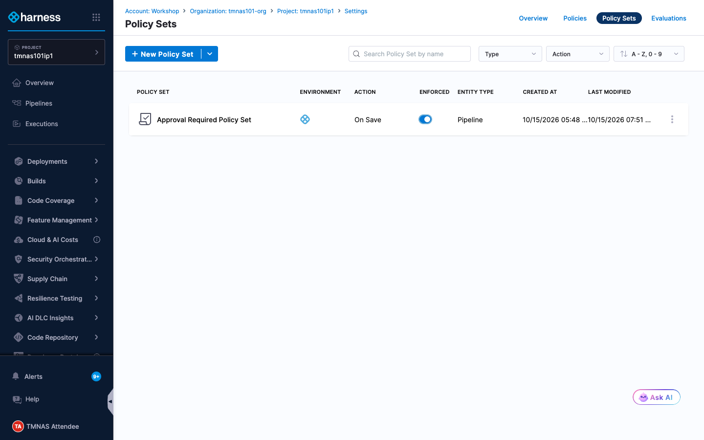

---

### Step 2: Governance in Action
1. Open your pipeline in Pipeline Studio
2. Make a small change (for example, add a tag to the pipeline) and click **Save**
3. Note that the save is blocked by the **Approval Required Policy**. Let's fix it!


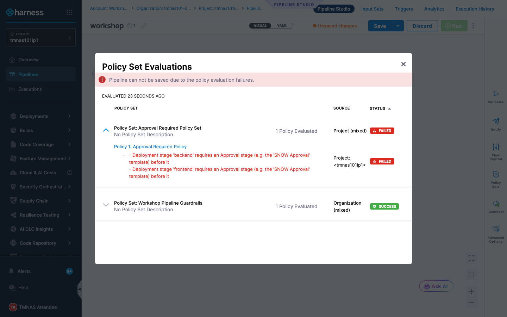

---

### Step 3: Add the ServiceNow Approval Stage
1. Hover before the **frontend** stage and click the **+** icon to add a new stage
2. Click **Use template**, select the **SNOW Approval** template and click **Use Template**


3. Configure the stage as follows and click **Set Up Stage**

| Input      | Value     | Notes |
| ---------- | ----------------------  | ----- |
| Stage Name | <pre>`ServiceNow Approval`</pre>| The name must match exactly. The close templates reference this stage to find the change number |
|`                `|`                            `|`                `|

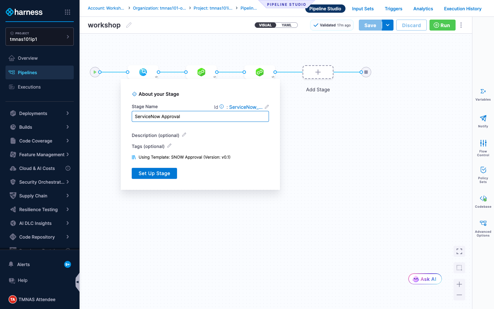

4. The template is pre-configured, so there are no inputs to fill in. Toggle **Overview** to see its two steps

| Step      | Type     | What it does |
| ---------- | ----------------------  | ----- |
| Create Ticket | ServiceNow Create | Raises a Normal change request with the pipeline name, execution number, triggering user, execution URL, justification, implementation, backout and test plans |
| Approval | ServiceNow Approval | Polls the change request every 30s. Approves when **State = Implement**, rejects when **State = Canceled** |
|`                `|`                            `|`                `|


5. Click on each step to see how it is configured. As a template user you cannot change this enterprise-approved template, only the template administrator can. Note how expressions such as `<+pipeline.executionUrl>` and `<+execution.steps.Create_Ticket.ticket.ticketNumber>` populate the ticket and the approval

---

### Step 4: Close the Change on Success
1. Navigate to the **backend** stage and, after the last step of the execution, click **Add Step**, select **Use template** and choose **ServiceNow Close Ticket**

| Input      | Value     | Notes |
| ---------- | ----------------------  | ----- |
| Name | <pre>`Close Ticket`</pre>| Sets the change to **Closed** with close code **Successful** and links the execution in the close notes |
|`                `|`                            `|`                `|


2. Click **Save**. No violations this time


---

### Step 5: Approve the Change as a Release Manager
1. Click **Run** to execute the pipeline

| Input      | Value     | Notes |
| ---------- | ----------------------  | ----- |
| Branch Name | <pre>`main`</pre>||
|`                `|`                            `|`                `|

2. The pipeline pauses on the **ServiceNow Approval** stage. The change request has already been raised on your behalf and moved to **Scheduled**

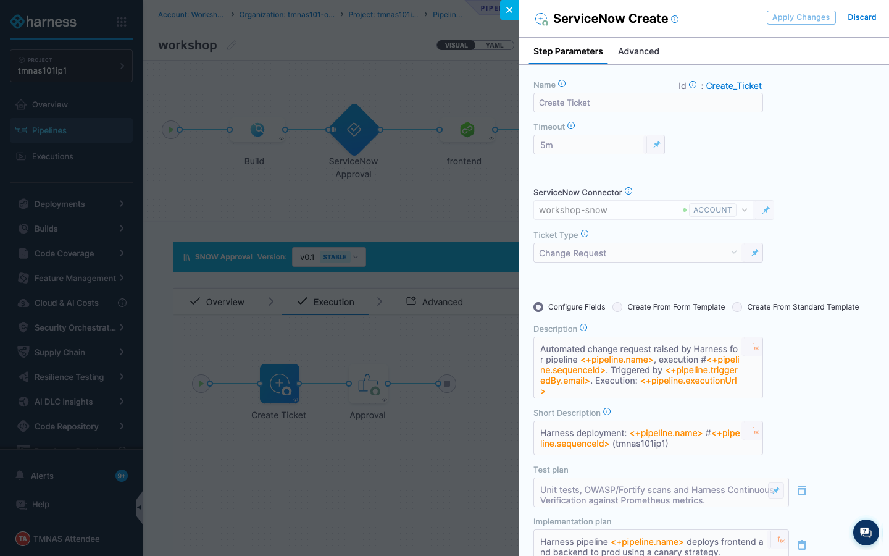

3. Click the **ServiceNow Approval** stage, select the **Approval** step and click the change number link in the step details to open the change request in a new tab
4. Log in to the ServiceNow sandbox with the credentials provided by your instructor. Review the metadata the pipeline added to the change, then click **Implement** in the top right corner

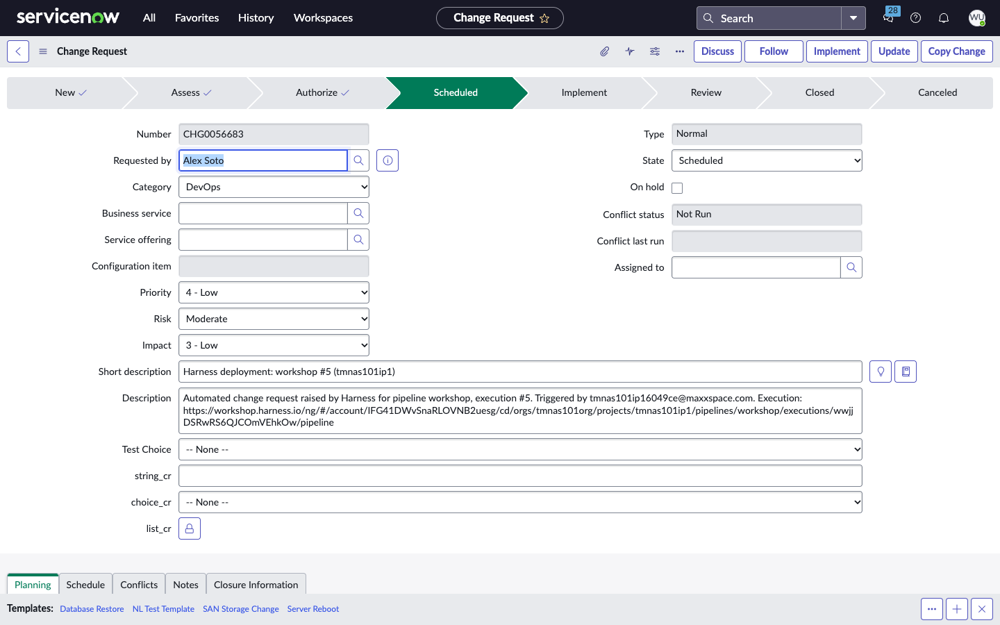
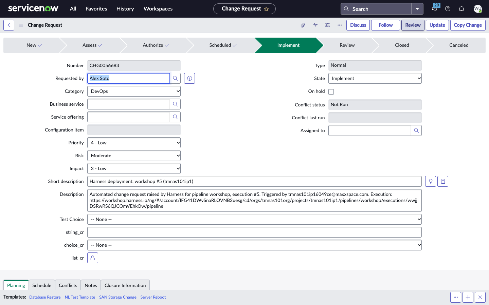

5. Switch back to Harness and watch the pipeline continue once the approval criteria are met. Approve the Harness Approval steps from Lab 6 as they come up. When the backend stage completes, **Close Ticket** closes the change as **Successful**


---

### Bonus Activities
- Run the pipeline again and this time **Cancel** the change in ServiceNow. Observe how the pipeline is rejected before anything is deployed to production
- What happens to the change if the release fails after it was approved? See Lab 9

---

## Value Callouts

| Aspect | Description |
| :--- | :--- |
| **Compliance as Code** | Change policy is enforced on every pipeline save, not by reviewing pipelines by hand. |
| **Zero Change Paperwork** | The pipeline raises the change request with full release metadata, so developers never fill in a change form. |
| **Auditable Trail** | Every release links its change request to the execution, from approval to closure. |


## Lab 8: Production Guardrails

## Key Outcomes
- Write guardrails that target specific environments and services
- Combine design-time (**On Save**) and runtime (**On Step**) policies
- Verify ServiceNow change details right before a production rollout

## Overview
An approval stage at the front of the pipeline is a good start, but production is special. In this lab the user enforces a policy that says *any deployment to the **prod** environment, or of the **backend** service, must include a policy check*, then adds a **Change Verified** policy step that confirms at runtime that the release is backed by an approved ServiceNow change.

---

## Walkthrough

### Step 1: Enforce the Production Guardrail
1. From the secondary menu, select **Project Settings** and select **Policies**
2. Select the **Policies** tab and open **Production Guardrail Policy**. Review the rego

| Rule | What it does |
| :--- | :--- |
| `protected_environments := {"prod"}` | Environments that need a policy check |
| `protected_services := {"backend"}` | Services that need a policy check, in any environment |
| `deny[msg]` | Fails any Deployment stage that targets a protected environment or service and has no step of type **Policy** |

3. Select the **Policy Sets** tab, find **Production Guardrail Policy Set** and toggle **Enforced** on


4. Open your pipeline in Pipeline Studio, make a small change and click **Save**. The save is blocked for **both** stages: frontend deploys to **prod**, and backend is a protected service


---

### Step 2: Add the Change Verified Step
The **Change Verified** step template is a **Policy** step that evaluates the **Change Verified Policy Set** (On Step) with this payload:

```json
{
  "changeNumber": "<+pipeline.stages.ServiceNow_Approval.spec.execution.steps.Create_Ticket.ticket.ticketNumber>",
  "approvalStatus": "<+pipeline.stages.ServiceNow_Approval.status>",
  "environment": "<+env.identifier>",
  "service": "<+service.identifier>"
}
```

The **Change Verified Policy** denies the step if the change number doesn't start with `CHG`, or if the ServiceNow Approval stage did not succeed.

1. Open the **frontend** stage and go to **Execution**. Hover **before** the **Rollout Deployment** step, click **+**, select **Use template** and choose **Change Verified**

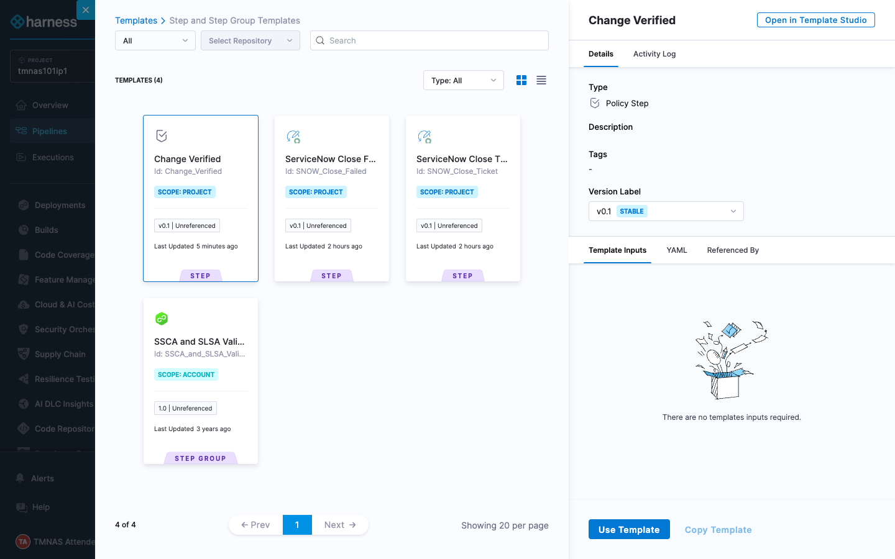

| Input      | Value     | Notes |
| ---------- | ----------------------  | ----- |
| Name | <pre>`Change Verified`</pre>||
|`                `|`                            `|`                `|


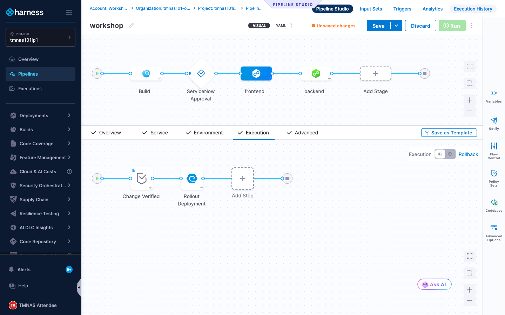

2. Open the **backend** stage, go to **Execution** and add the same template **before** the **Canary Deployment** step group


3. Click **Save**. The Production Guardrail is satisfied this time

---

### Step 3: Run the Pipeline
1. Click **Run** and approve the change in ServiceNow (**Implement**) as in Lab 7
2. When each deployment stage starts, click the **Change Verified** step. The logs show the policy set passed. Select the **Input** tab to see the change number, approval status, environment and service that were evaluated


3. Approve the Harness Approval steps. The pipeline completes and **Close Ticket** closes the change


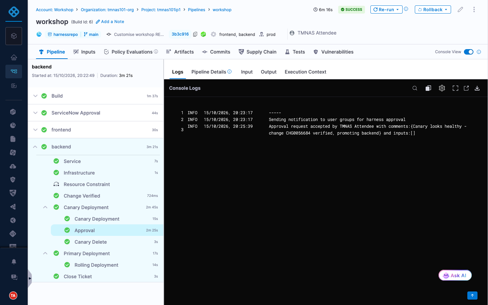

---

### Bonus Activities
- Add `"qa"` to `protected_environments` in the Production Guardrail policy. Which of your stages would be affected?
- Open the **Policy Evaluations** tab of the execution to see every policy that was evaluated, both On Save and On Step

---

## Value Callouts

| Aspect | Description |
| :--- | :--- |
| **Targeted Guardrails** | Policies apply to the environments and services that matter, without slowing down everything else. |
| **Design-time and Runtime** | On Save policies shape the pipeline; On Step policies check real values right before the rollout. |
| **Evidence for Auditors** | The evaluated change number and approval status are stored with every execution. |


## Lab 9: Resilience Testing & Automated Rollback

## Key Outcomes
- Enable resilience testing on an existing deployment environment
- Build a chaos experiment from an out-of-the-box fault and an HTTP probe
- Run chaos against the canary in parallel with continuous verification
- Roll back automatically and record the failed release in ServiceNow

## Overview
Continuous verification from Lab 4 compares the canary against the stable pods. In this lab the user injects a memory hog into the backend canary while **Verify** runs, so verification catches the misbehaving canary and rolls the release back on its own. A rollback step then closes the ServiceNow change as **Unsuccessful**, so the change record always reflects what really happened.

---

## Walkthrough

### Step 1: Enable Chaos on Your Environment
1. From the module selection menu select **Resilience Testing**
2. From the left hand menu, go to **Project Settings** and select **Resilience Test Infrastructures**
3. On the **Kubernetes (Harness Infrastructure)** tab click **+ New Infrastructure**, select the **prod** environment and click **Continue**
4. Create the infrastructure with the following values and click **Save**

| Input      | Value     | Notes |
| ---------- | ----------------------  | ----- |
| Name | <pre>`k8s-chaos`</pre>| A chaos enabled infrastructure on the same cluster you deploy to |
| Infrastructure Type | Kubernetes (Direct Connection) ||
| Connector | k8s-prod ||
| Namespace | <pre>`devsecops-<project_id>`</pre>| The namespace your frontend and backend are deployed to |
|`                `|`                            `|`                `|

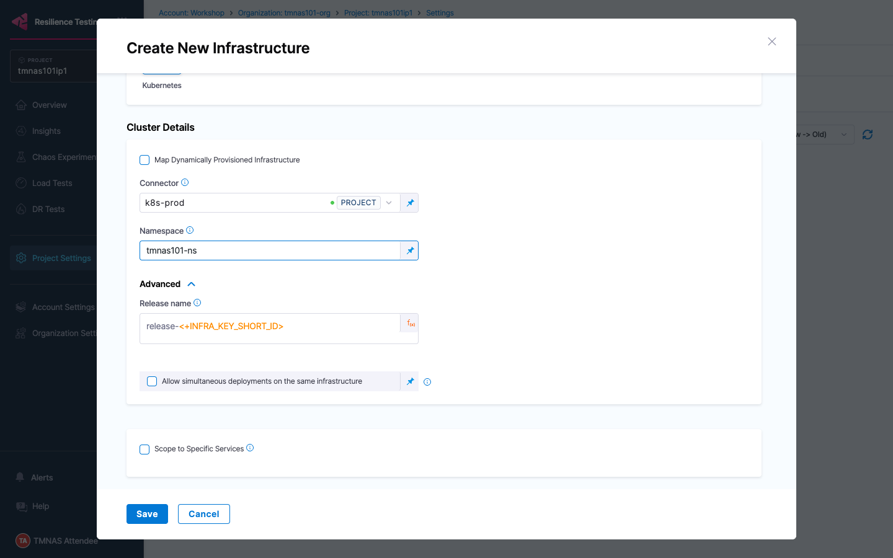

5. Harness offers to onboard the infrastructure with service discovery. You do not need it for this lab, click **Exit**

---

### Step 2: Create a Health Probe
1. From **Project Settings** select **Resilience Test Probes** and click **+ New Probe**
2. Select **Kubernetes** and then **HTTP Probe**

| Input      | Value     | Notes |
| ---------- | ----------------------  | ----- |
| Name | <pre>`frontend-health`</pre>||
| URL | The value of your **lab_endpoint** project variable | Your application's endpoint |
| Method | GET ||
| Criteria | == ||
| Response Code | <pre>`200`</pre>||
|`                `|`                            `|`                `|

3. Move to the next tab **Run Properties**

| Input      | Value     | Notes |
| ---------- | ----------------------  | ----- |
| Timeout | <pre>`20s`</pre>||
| Interval | <pre>`2s`</pre>||
| Attempt | <pre>`5`</pre>||
| Initial Delay | <pre>`5s`</pre>||
|`                `|`                            `|`                `|

4. Click **Next** and then **Create Probe**

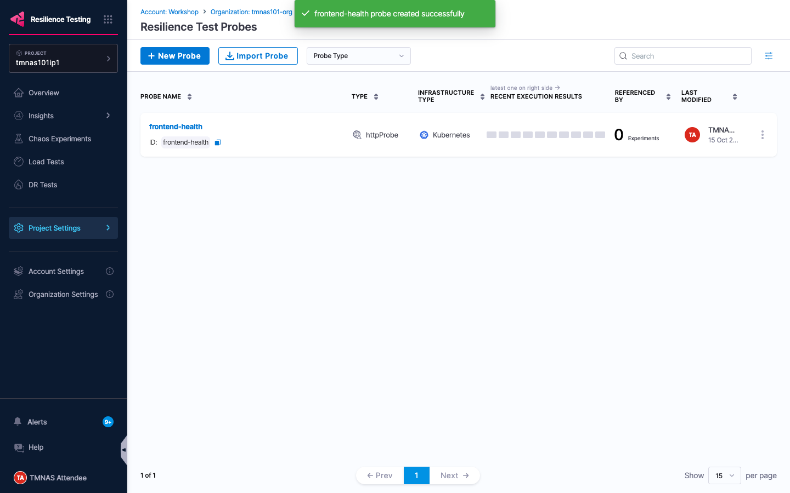

---

### Step 3: Create the Experiment
1. From the left hand menu, go to **Chaos Experiments**
2. Select **+ New Experiment** and then **Create from scratch**

| Input      | Value     | Notes |
| ---------- | ----------------------  | ----- |
| Name | <pre>`pod-memory`</pre>||
|`                `|`                            `|`                `|

3. Select **Kubernetes** and click **Select a resilience test infrastructure**
4. Select the **prod** environment, then the **k8s-chaos** infrastructure, and click **Apply**. Infrastructures without chaos enabled are shown as **Chaos Not Enabled** and can't be selected

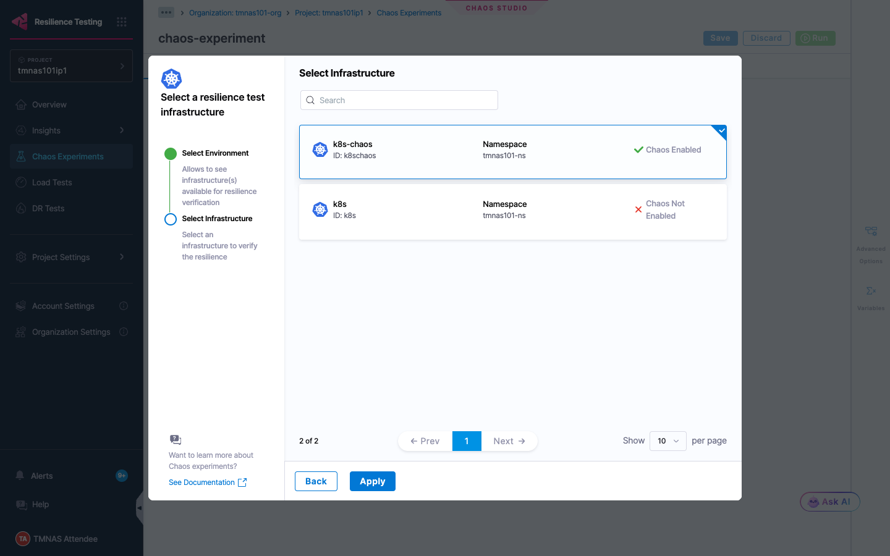

5. Click **Next** to navigate to the experiment builder
6. Click on the **+** and select **Add a fault**
7. From the list of available faults select **Pod Memory Hog** and click **Add to Experiment**
8. On the **Target Application** tab

| Input      | Value     | Notes |
| ---------- | ----------------------  | ----- |
| Target Workload Kind | deployment ||
| Target Workload Namespace | <pre>`devsecops-<project_id>`</pre>| Select the namespace from the dropdown |
| Target Workload Names | <pre>`backend-<project_id>-deployment-canary`</pre>| The canary only exists while the pipeline runs, so type the name and select it |
| Target Workload Labels | Leave empty ||
|`                `|`                            `|`                `|

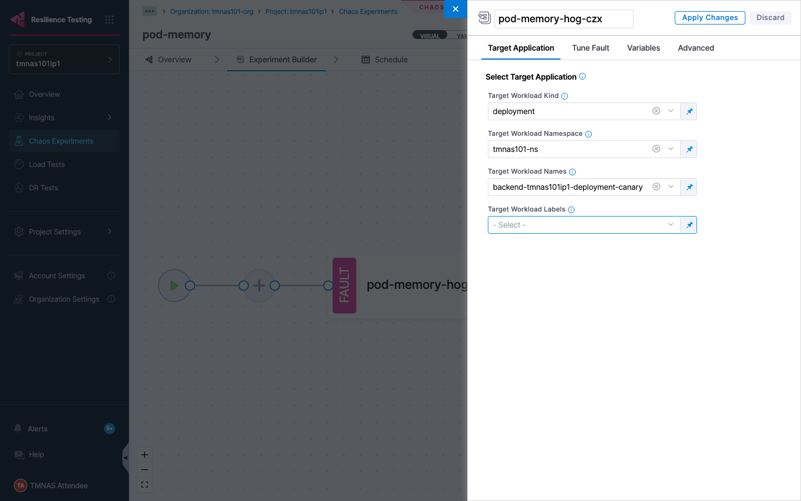

9. On the **Tune Fault** tab

| Input      | Value     | Notes |
| ---------- | ----------------------  | ----- |
| Total Chaos Duration | <pre>`600`</pre>||
| Memory Consumption | <pre>`300`</pre>| MB, well above the 150MB Pod Memory threshold of the backend monitored service |
| Number of workers | <pre>`1`</pre>||
| Pod affected percentage | <pre>`100`</pre>||
|`                `|`                            `|`                `|

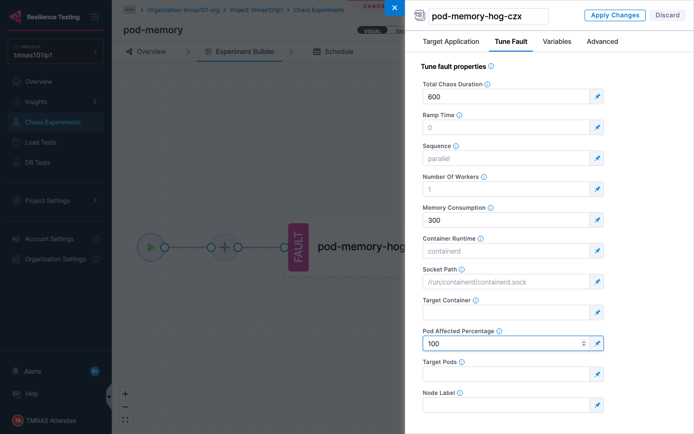

10. Click **Apply Changes**
11. Hover over the fault, select **Add a parallel node -> Add a probe**, choose **frontend-health** and click **Add to Experiment**, then **Apply Changes**
12. Click **Save**

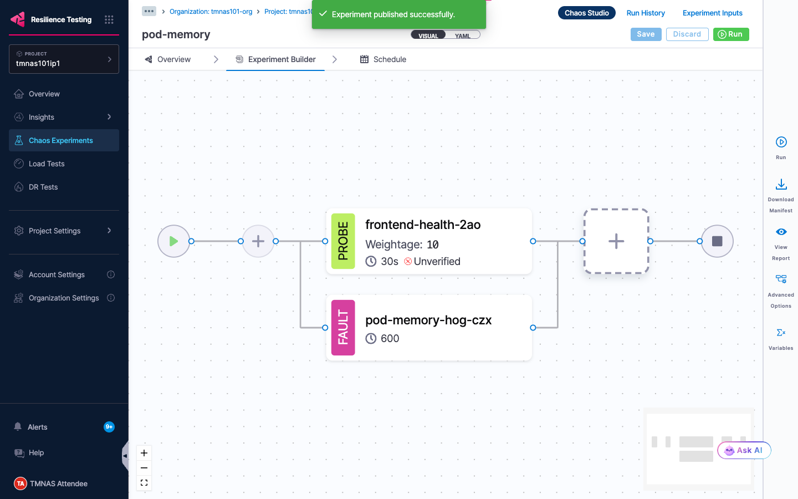

---

### Step 4: Run Chaos Alongside Verify
1. From the module selection menu select **Continuous Delivery & GitOps** and open your pipeline
2. In the **backend** stage, open the **Verify** step added in Lab 4 and update it

| Input      | Value     | Notes |
| ---------- | ----------------------  | ----- |
| Sensitivity | Low | How sensitive the ML algorithms are to deviation from the baseline |
| Duration | 10 min | Long enough for the memory hog to take effect |
|`                `|`                            `|`                `|

3. Select the **Advanced** tab of the Verify step. Under **Failure Strategy**, change the action for verification failures from **Manual Intervention** to **Rollback Stage** so a failed verification rolls back without waiting for a human
4. Under the **Verify** step click on the plus icon to add a new step in parallel
5. Add a **Chaos** step with the following configuration

| Input      | Value     | Notes |
| ---------- | ----------------------  | ----- |
| Name | <pre>`Chaos`</pre>||
| Select Chaos Experiment | pod-memory ||
| Expected Resilience Score | <pre>`50`</pre>||
|`                `|`                            `|`                `|

6. Click **Apply Changes**

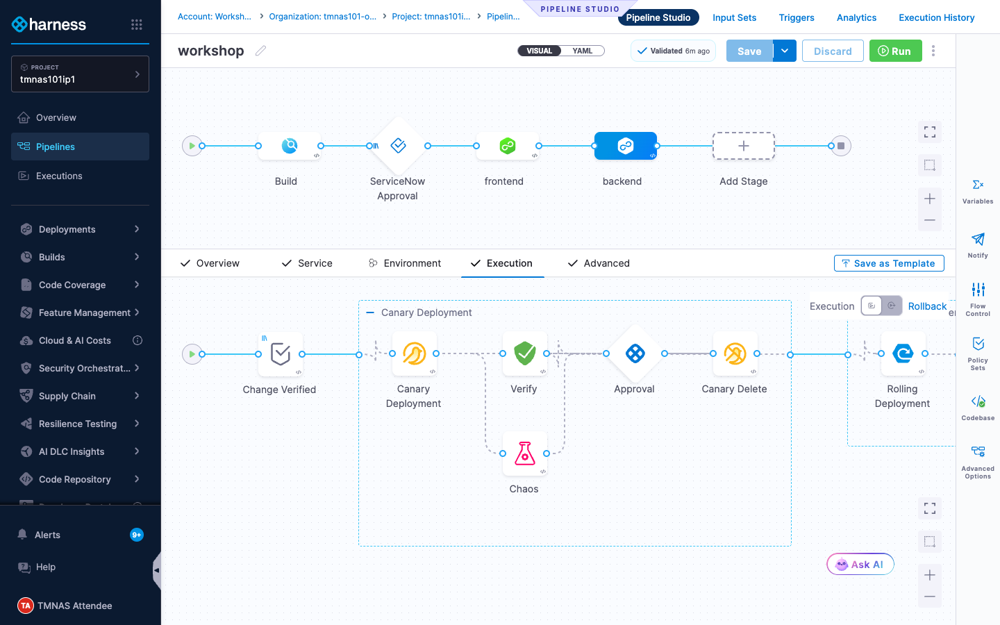

---

### Step 5: Close the Change on Failure
1. In the **backend** stage **Execution**, toggle the **Rollback** view in the top right corner

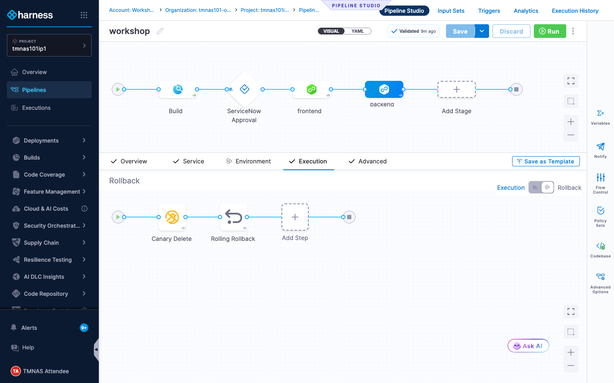

2. Click the **+** after the last rollback step, select **Use template** and choose **ServiceNow Close Failed**

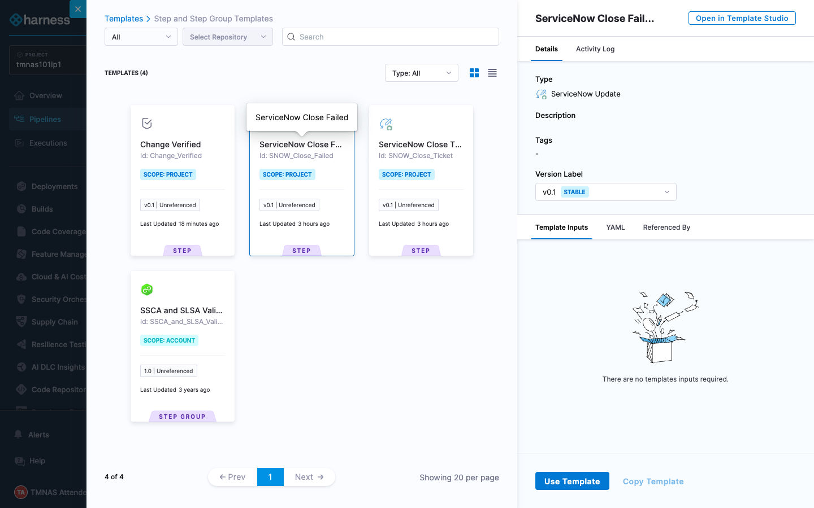

| Input      | Value     | Notes |
| ---------- | ----------------------  | ----- |
| Name | <pre>`Close Failed Ticket`</pre>| Sets the change to **Closed** with close code **Unsuccessful** and links the failed execution in the close notes |
|`                `|`                            `|`                `|

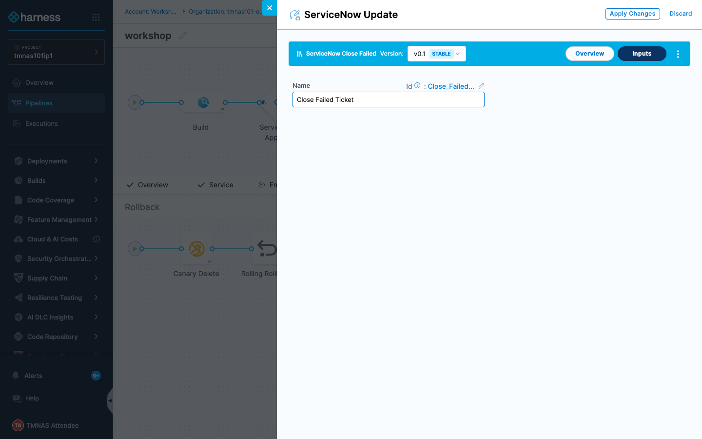

3. Apply the changes and **Save** the pipeline


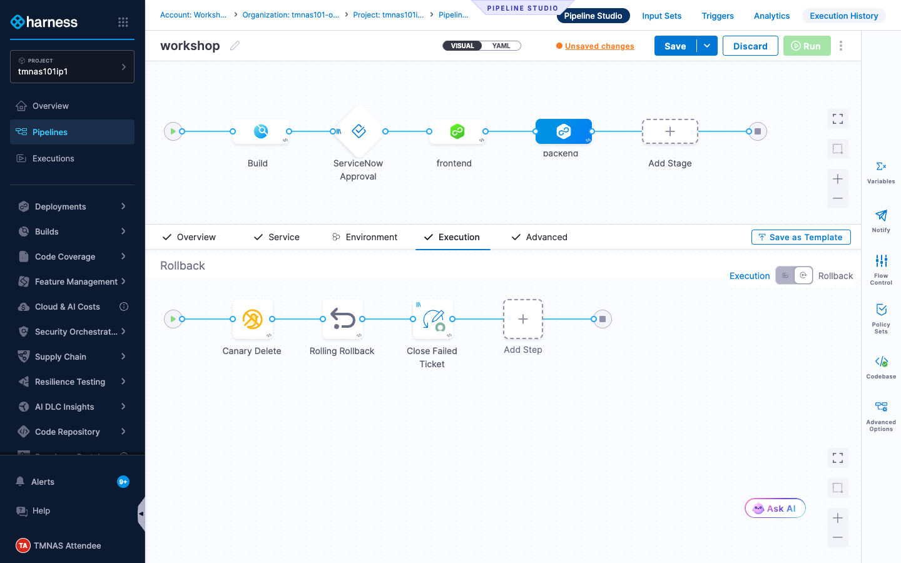

---

### Step 6: Run and Review
1. Click **Run**, approve the change in ServiceNow as in Lab 7 and approve the Harness Approval steps
2. Once the canary is deployed, Verify and Chaos run side by side. The memory hog pushes the canary pod's memory well above the stable pods'
3. Verify compares the canary against the stable baseline and fails: **Pod Memory** is flagged **Unhealthy** on the canary node only

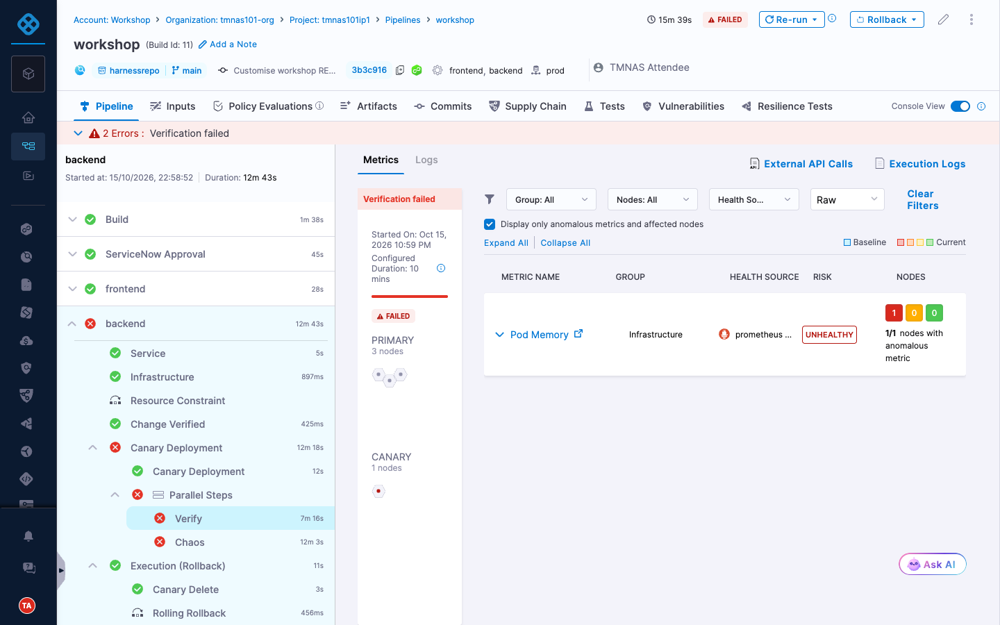

4. Harness rolls back the stage: **Canary Delete**, **Rolling Rollback** and then **Close Failed Ticket**. The release never reaches the stable deployment

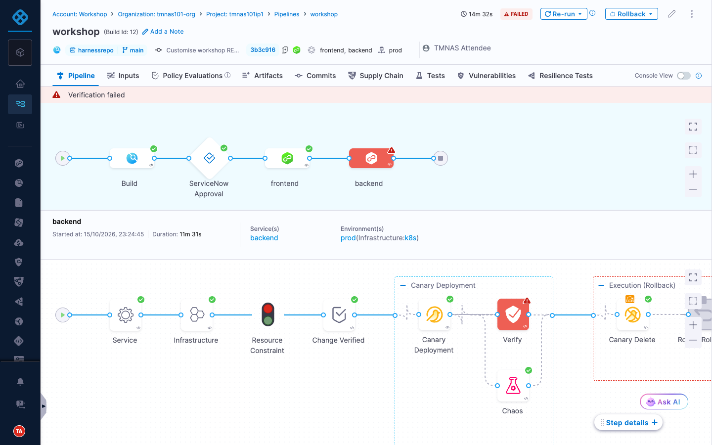

5. Open the **Resilience Tests** tab of the execution. The resilience score is 100% because the **frontend-health** probe kept passing: the fault stayed on the backend canary and never reached users, while Verify stopped the release

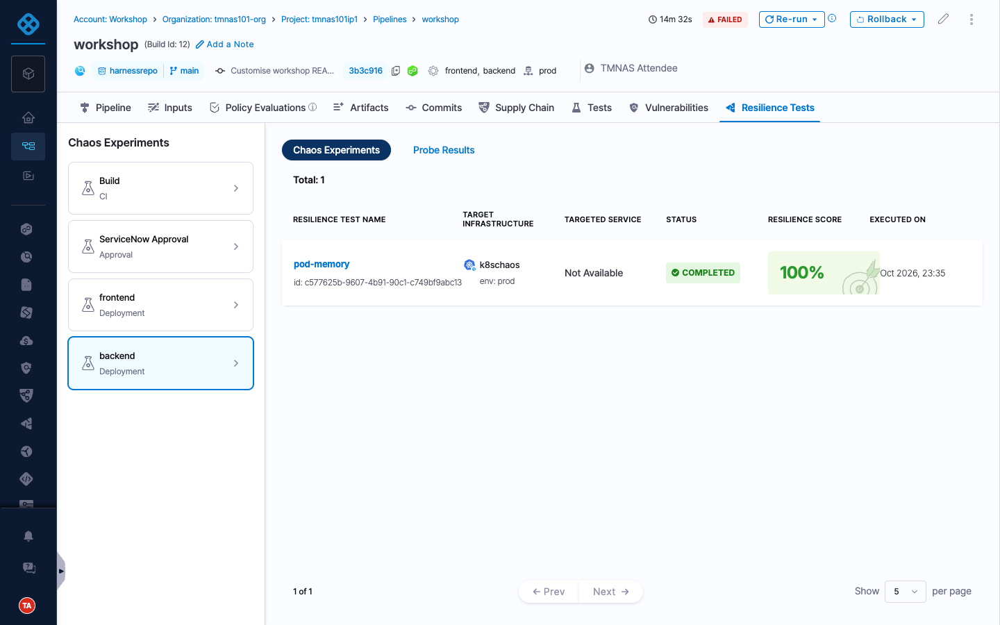

6. Open the change request in ServiceNow. It is **Closed** with close code **Unsuccessful**, and the **Closure Information** tab links to the failed execution


---

## Value Callouts

| Aspect | Description |
| :--- | :--- |
| **Resilience in the Pipeline** | Chaos experiments run as part of every release, not as a separate exercise. |
| **Small Blast Radius** | The fault targets only the canary, so users stay on the healthy stable version. |
| **Self-healing Releases** | Continuous verification detects the regression and rolls back without human intervention. |
| **Accurate Change Records** | ServiceNow always reflects the real outcome of a release, including automated rollbacks. |


## Lab 10: Governance / Policy as Code (Advanced)

## Key Outcomes
- Block critical CVEs from reaching production  
- Enforce security policies during runtime  

## Overview
In this lab, the user creates an advanced policy that blocks deployments when critical vulnerabilities are detected by security scanners like OWASP.

---

## Walkthrough

### Step 1: Create a Policy to Block Critical CVEs
1. From the secondary menu, select **Project Settings**
2. Select **Policies**
3. Click the **Policies** tab
4. Click **+ New Policy**

| Input      | Value     | Notes |
| ---------- | ----------------------  | ----- |
| Name | <pre>`Runtime OWASP CVEs`</pre>||
|`                `|`                            `|`                `|

5. Click **Apply**
6. Set the REGO policy to the following and click **Save**

```opa
package pipeline_environment
deny[sprintf("Node OSS Can't contain any critical vulnerability '%d'", [input.NODE_OSS_CRITICAL_COUNT])] {  
   input.NODE_OSS_CRITICAL_COUNT != 0
}
```

---

### Step 2: Create a Policy Set
1. Select the **Policy Sets** tab
2. Click **+ New Policy Set** and configure as follows:

| Input      | Value     | Notes |
| ---------- | ----------------------  | ----- |
| Name | <pre>`Criticals Not Allowed`</pre>||
| Entity Type | Custom ||
| Event Evaluation | On Step ||
| Policy to Evaluate | Runtime OWASP CVEs ||
|`                `|`                            `|`                `|

3. Click **Apply**
4. Click **Finish**
5. Toggle the **Enforced** button

---

### Step 3: Add Policy to Pipeline
1. Open your pipeline
2. Go to a previous execution and copy the **CRITICAL** output variable from the OWASP step like so:


3. Select the **frontend** stage
4. Before the **Rollout Deployment** Step Group, add a **Policy** type step

| Input      | Value     | Notes |
| ---------- | ----------------------  | ----- |
| Name | <pre>`Policy - No Critical CVEs`</pre>||
| Entity Type | Custom ||
| Policy Set | Criticals Not Allowed | Make sure to select the Project tab |
| Payload | <pre>`{"NODE_OSS_CRITICAL_COUNT": <variable>}`</pre>| Set the field type to Expression, then replace `<variable>` with the OWASP output variable CRITICAL path |
|`                `|`                            `|`                `|

5. Click **Apply Changes**

---

### Step 4: Test the Policy
1. Save the pipeline and execute
2. Note that the pipeline fails at the policy evaluation step due to critical vulnerabilities being found by OWASP

> [!TIP]
> The change request raised for this run stays in **Implement**. Cancel it in ServiceNow, or add the **ServiceNow Close Failed** template to the frontend rollback steps as you did for the backend in Lab 9.

---

## Value Callouts

| Aspect | Description |
| :--- | :--- |
| **Security by Default** | Critical vulnerabilities are automatically blocked from production. |
| **Runtime Enforcement** | Policies evaluate real scan results, not just configuration. |
| **Risk Mitigation** | High-severity issues are caught before deployment, reducing attack surface. |
| **Compliance Automation** | Security policies are enforced consistently across all pipelines without manual oversight. |
